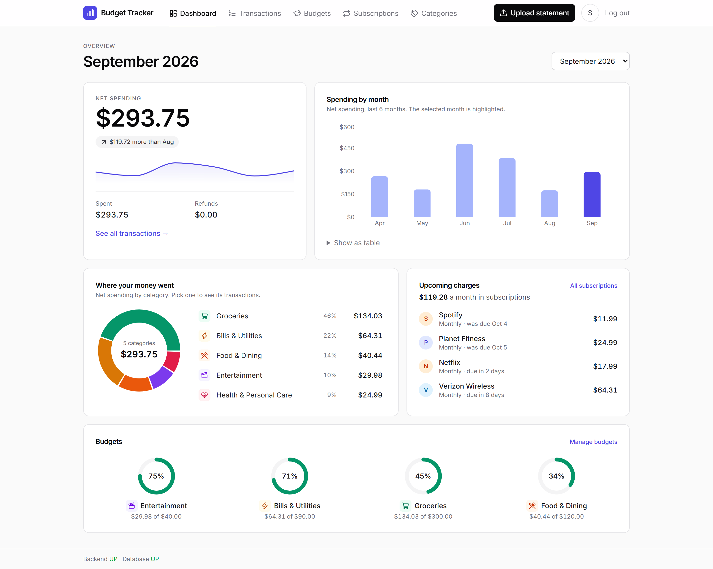
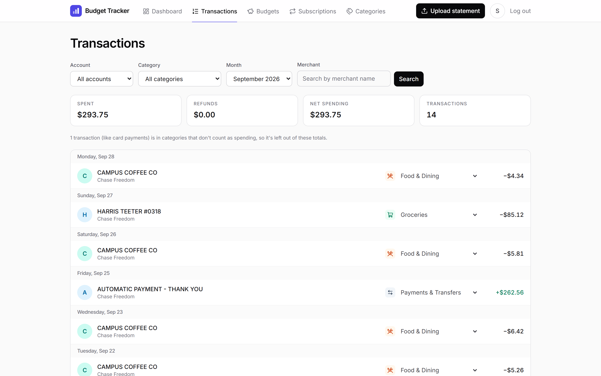
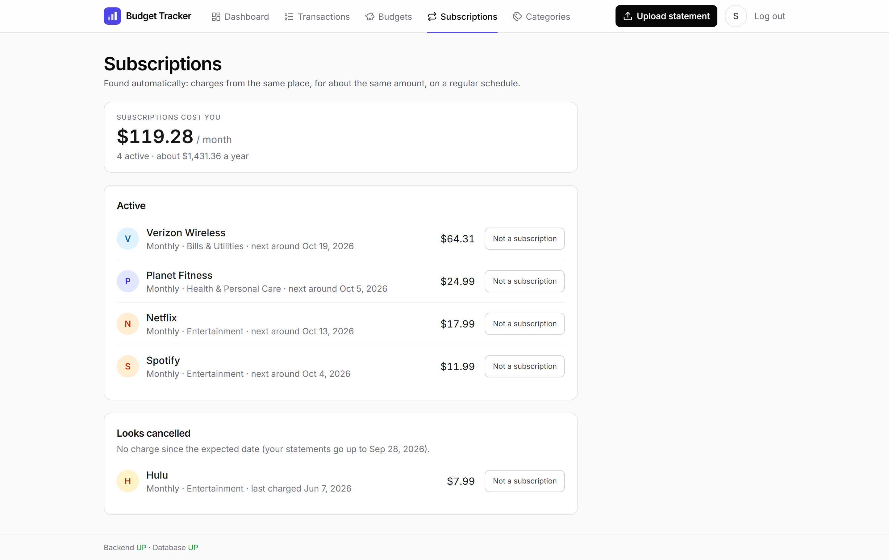
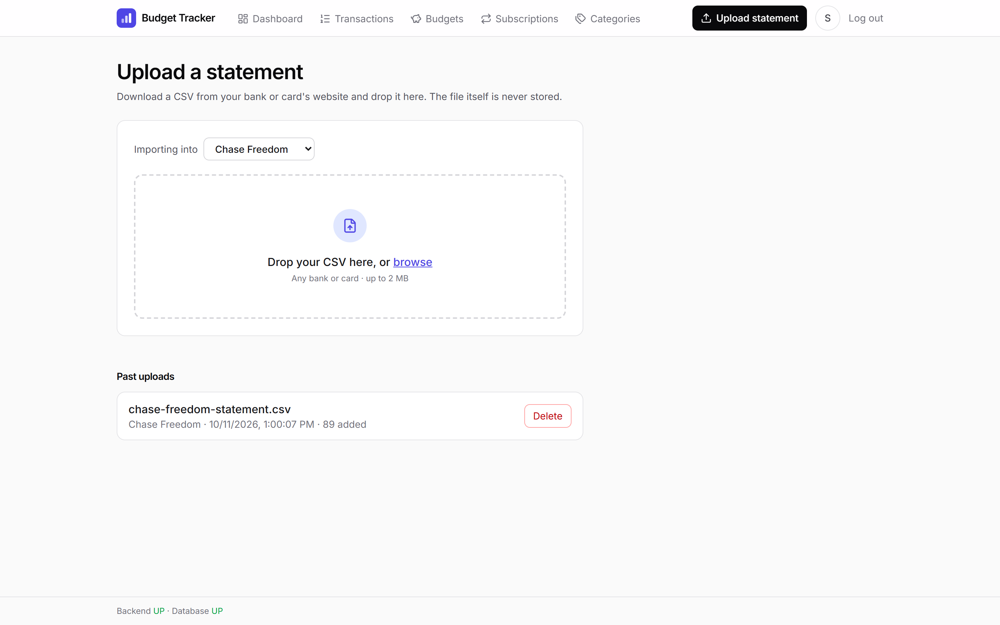
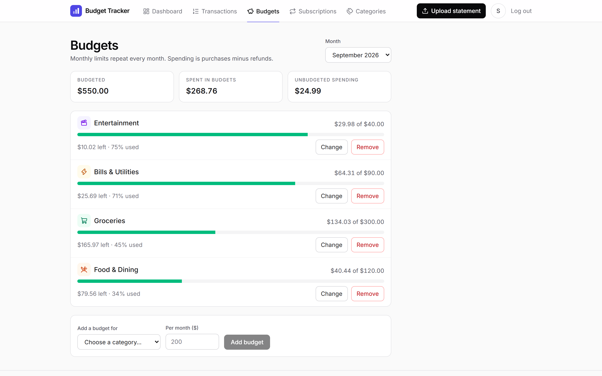
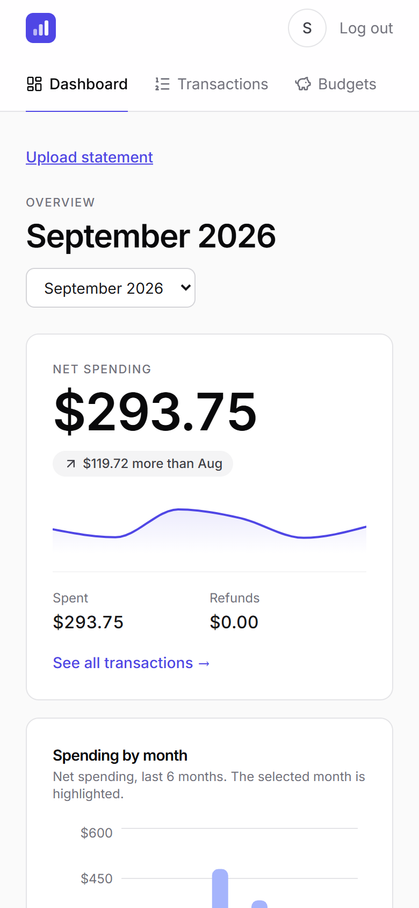

# Budget Tracker

[](https://github.com/saakethsrikakolapu/budget-tracker/actions/workflows/ci.yml)

**A privacy-first budget tracker for students. No bank login, just upload your statements.**

Export a CSV from any bank or card, drop it in, and see where your money goes: transactions sorted into
categories, monthly budgets, and the subscriptions you forgot about. The app never connects to your bank.

**Live demo:** https://budget-tracker-saaketh1.vercel.app (free hosting: the first visit can take about a
minute while the server wakes up). Try it with [`samples/subscriptions-6-months.csv`](samples/subscriptions-6-months.csv)
or any file in [`samples/layouts/`](samples/layouts) (all fake data).



## What it does

- **Reads any bank's CSV.** No per-bank templates: columns are worked out from the values themselves
  (which column holds dates, which holds money, debit/credit pairs, running balances to ignore). Tested
  against 12 layouts from Chase, Bank of America, Wells Fargo, Capital One, Amex, Discover, Citi, Apple
  Card, US Bank, and PNC. The upload is one step: drop the file, read the summary, import.
- **Sorts transactions automatically,** from the bank's own labels or a dictionary of 480+ merchants.
  Fix one and it asks *"Always put STREAMFLIX in Entertainment?"*; one click moves every past and future
  transaction from that merchant, with Undo.
- **Finds subscriptions and bills** (same merchant, similar amount, regular schedule), shows what they
  cost per month and when the next charge is due, and flags ones that look cancelled.
- **Monthly budgets** per category, with progress rings on the dashboard.
- **Never double-counts.** Re-uploading an overlapping statement skips what's already there, and any
  import can be undone.
- **Your data stays yours:** delete your account and everything in it in one step.

| Transactions | Subscriptions |
|---|---|
|  |  |
| **Upload** | **Budgets** |
|  |  |

<p align="center"></p>

## How it works

```
React + TypeScript (Vercel) ──/api──▶ Spring Boot (Render) ──▶ PostgreSQL (Neon)
                                      Spring Security sessions stored in Postgres
```

- **CSV inference** ([`imports/csv/ColumnInference.java`](backend/src/main/java/com/saaketh/budget/imports/csv/ColumnInference.java)):
  scores every column by its values, not its header. The earlier of two date columns is the transaction
  date; a column that changes by exactly each row's amount is a running balance and is ignored; the
  description is the text column with the most variety. Formats you confirm are remembered per file shape.
- **Duplicate detection:** each row gets a SHA-256 fingerprint of its date, amount, and description plus
  an occurrence number, so two genuinely identical coffees on one day both count, but re-importing the
  same file adds nothing. A unique (account, fingerprint, occurrence) constraint keeps it safe even if
  two uploads race.
- **Categorization order:** your manual choices > your "always" choices > the bank's label > the
  merchant dictionary > Uncategorized. Changing a choice re-sorts past transactions (except manual ones).
- **Recurring detection** ([`recurring/RecurringDetector.java`](backend/src/main/java/com/saaketh/budget/recurring/RecurringDetector.java)):
  descriptions are reduced to a merchant key (`PURCHASE AUTHORIZED ON 10/27 NETFLIX.COM CARD 1234` →
  `NETFLIX COM`), then each merchant's gaps are matched to a cadence (weekly to yearly, allowing one
  skipped period) and amounts must stay within 25% (50% for bills with spotless timing). Computed on
  request, so it's never out of date.
- **Money** is `BigDecimal` in Java and `NUMERIC(12,2)` in Postgres, never floating point. The schema is
  managed only by Flyway migrations.

### Recurring detection accuracy

Measured by [`RecurringAccuracyTest`](backend/src/test/java/com/saaketh/budget/recurring/RecurringAccuracyTest.java)
on 200 synthetic students (18 months each, seeded so the numbers are reproducible). The data includes the
hard cases on purpose: price increases, posting-date jitter, a skipped month, varying phone and electric
bills, cancelled and new subscriptions, and look-alikes that aren't recurring (coffee, groceries, rides,
takeout at a steady price).

| Metric | Result |
| --- | --- |
| Precision (flagged charges that really are recurring) | 0.999 (1 false positive in 1,421) |
| Recall (recurring charges found) | 0.999 (1 missed of 1,421) |
| Schedule identified correctly | 100% |
| Active vs. cancelled correct | 100% |

The data is synthetic, so this shows the detector handles the cases it was designed for, not how it does
on every real statement. Known limits: two one-off purchases from the same store about a year apart can
look like a yearly charge, and merchants whose reference codes are all letters may not group together.

## Security, privacy, and accessibility

- Server-side sessions (Spring Session JDBC) in an HttpOnly, SameSite=Lax, Secure cookie; CSRF tokens on
  every change; BCrypt passwords; session id rotated at login.
- Failed logins are rate-limited per email (5) and per IP (30) per 15 minutes, answering 429 with
  Retry-After, without revealing which emails exist.
- Uploaded files are read once and never stored; every query is scoped to the logged-in user. Deleting
  your account removes all your data (every table cascades from the user) and logs out every device.
- Every page passes an [axe-core](https://github.com/dequelabs/axe-core) audit (WCAG 2.2 AA + best
  practices): keyboard navigation with a skip link, visible focus, 4.5:1 text contrast, labeled controls,
  charts with table or list alternatives, and reduced motion respected.

## Tech stack

- **Backend:** Java 25, Spring Boot 4 (Web, Security, Data JPA, Validation, Session JDBC), PostgreSQL, Flyway
- **Frontend:** React 19, TypeScript, Vite, Tailwind CSS 4, Recharts, Lucide icons, Inter (self-hosted)
- **Testing:** JUnit 5, Spring Boot tests with Testcontainers (real Postgres), 198 backend tests
- **Dev and CI:** Docker Compose, GitHub Actions (build, test, lint on every push)

## Run locally

Requires Java 25, Node 22+, and Docker.

```bash
cp .env.example .env            # then set DB_PASSWORD in .env
docker compose up -d            # start Postgres
cd backend && ./mvnw spring-boot:run          # terminal 1: API on :8080
cd frontend && npm install && npm run dev     # terminal 2: app on :5173
```

Open http://localhost:5173, create an account, and upload a file from [`samples/`](samples).
`http://localhost:8080/api/health` returns `{"status":"UP","database":"UP"}`.

- **Tests:** `cd backend && ./mvnw test` (starts its own throwaway Postgres, so it only needs Docker).
- **Screenshots:** with the app running, `node scripts/take-screenshots.mjs` regenerates
  `docs/screenshots/` using a throwaway demo account (headless Edge or Chrome, no dependencies).

## Deployment

| Part | Host | Config |
|---|---|---|
| Frontend | Vercel (root directory `frontend`) | [`frontend/vercel.json`](frontend/vercel.json) forwards `/api/*` to the backend and serves `index.html` for app routes |
| Backend | Render web service (Docker, root directory `backend`) | [`backend/Dockerfile`](backend/Dockerfile), `prod` profile in [`application-prod.properties`](backend/src/main/resources/application-prod.properties) |
| Database | Neon Postgres | Schema created by Flyway on startup |

Backend environment variables: `DATABASE_URL` (JDBC URL with `sslmode=require`), `DATABASE_USERNAME`,
`DATABASE_PASSWORD`.

## Roadmap

- [x] Accounts, CSV import from any bank, duplicate detection, undo
- [x] Categories, automatic sorting, budgets, dashboard
- [x] Recurring charge detection with measured accuracy
- [x] Redesign, simpler flows, accessibility pass
- [ ] ML categorization service (Python, scikit-learn) compared against the rule-based baseline
- [ ] Password reset and email verification
