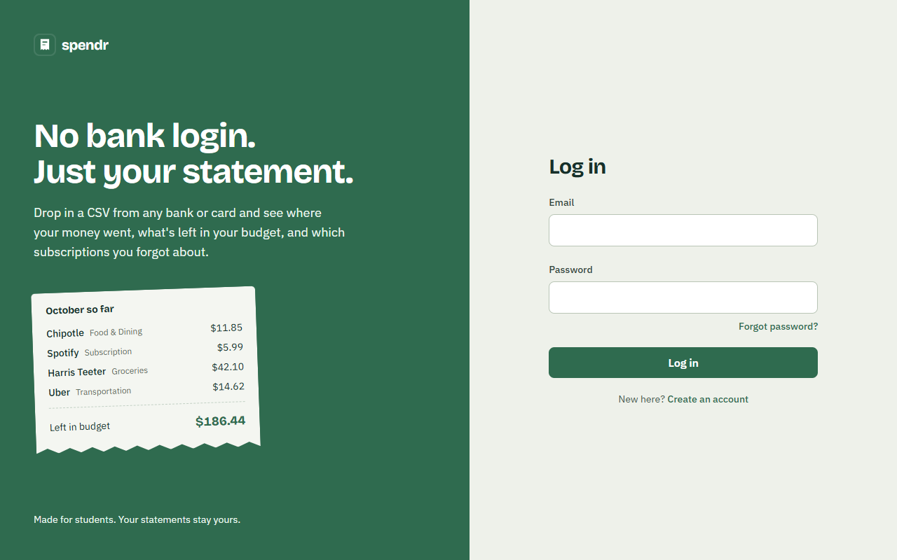

# Budget Tracker

**A privacy-first budget tracker for students. No bank login, just upload your statements.**

👉 **[www.8022029.xyz](https://www.8022029.xyz)** (free to use; the first visit can take about a minute while the server wakes up)



## What you can do

- **Upload a statement from any bank or card.** Download a CSV from your bank's website and drop it in.
  The app figures out the columns on its own.
- **See where your money goes.** Transactions are sorted into categories automatically, with a dashboard
  of your spending by category and by month.
- **Set monthly budgets** and see how much is left in each category.
- **Find your subscriptions,** including ones you forgot, with what they cost per month and when the
  next charge is due.
- **Fix anything in one click.** Change a category and the app offers to do the same for that merchant
  from now on.

## Getting started

1. **Create an account** at [www.8022029.xyz](https://www.8022029.xyz).
2. **Download a statement as a CSV** from your bank or card website (usually under *Statements*,
   *Activity*, or *Download transactions*; choose CSV). A few months of history works best.
3. **Upload it.** Check the one-line summary and click *Import*. Uploading an overlapping statement
   later is fine: transactions already imported are skipped.
4. **Look over anything Uncategorized** and pick a category. Set a budget or two if you like.

No statement handy? Try the fake sample [`samples/subscriptions-6-months.csv`](samples/subscriptions-6-months.csv).

## Your privacy

- The app **never connects to your bank**. It only sees the files you choose to upload.
- Uploaded files are read once and **not stored**; only the transactions are saved, visible only to you.
- You can **undo any upload** or **delete your account and all its data** at any time (Account page).

## Good to know

- **PayPal, Venmo, Zelle and Cash App:** your bank only sees the money going to the app, not the store,
  so those purchases can't be categorized automatically. Pick a category once and choose
  *"Yes, always"* to file them all the same way.
- **"Suggested" categories** are the app's best guess for unfamiliar descriptions. Click the badge to
  confirm, or choose a different category.
- **Light and dark mode** follow your device; switch in the header.

| Dashboard | On a phone |
|---|---|
|  |  |

## For developers

Java 25 and Spring Boot backend, React and TypeScript frontend, PostgreSQL, and a category model trained
in Python with scikit-learn. How it all works, the measured accuracy, and deployment details are in
[docs/HOW-IT-WORKS.md](docs/HOW-IT-WORKS.md).

```bash
cp .env.example .env            # then set DB_PASSWORD in .env
docker compose up -d            # start Postgres
cd backend && ./mvnw spring-boot:run          # terminal 1: API on :8080
cd frontend && npm install && npm run dev     # terminal 2: app on :5173
```

Requires Java 25, Node 22+, and Docker. Then open http://localhost:5173.
